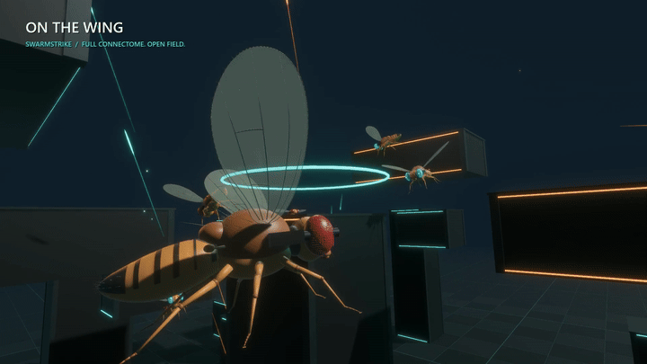
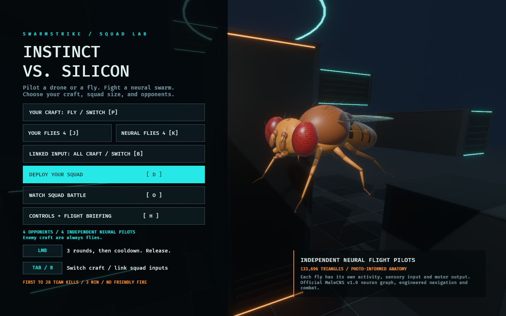
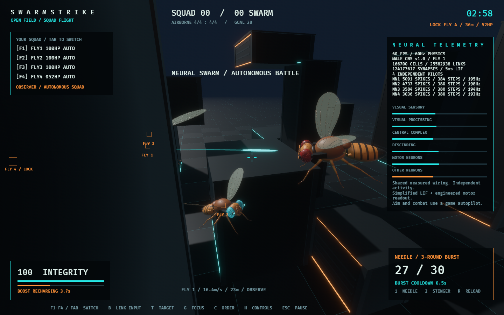
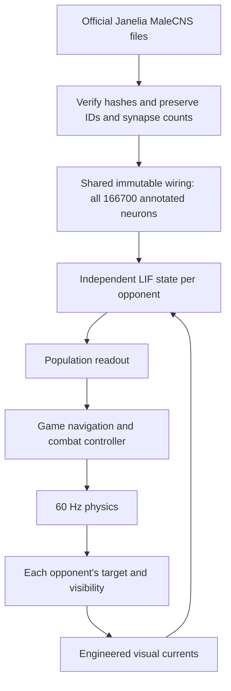
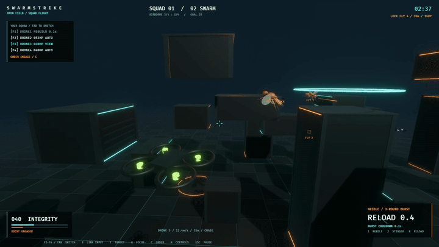
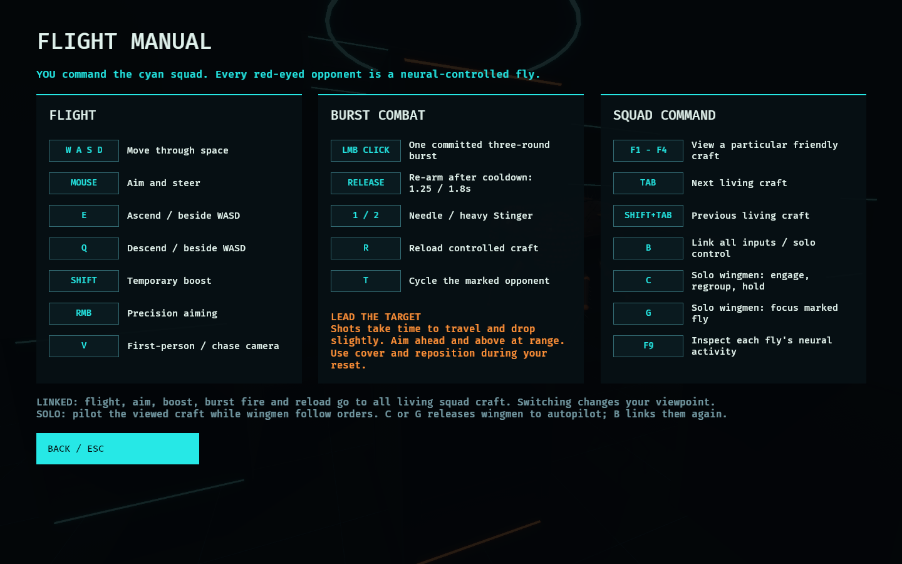
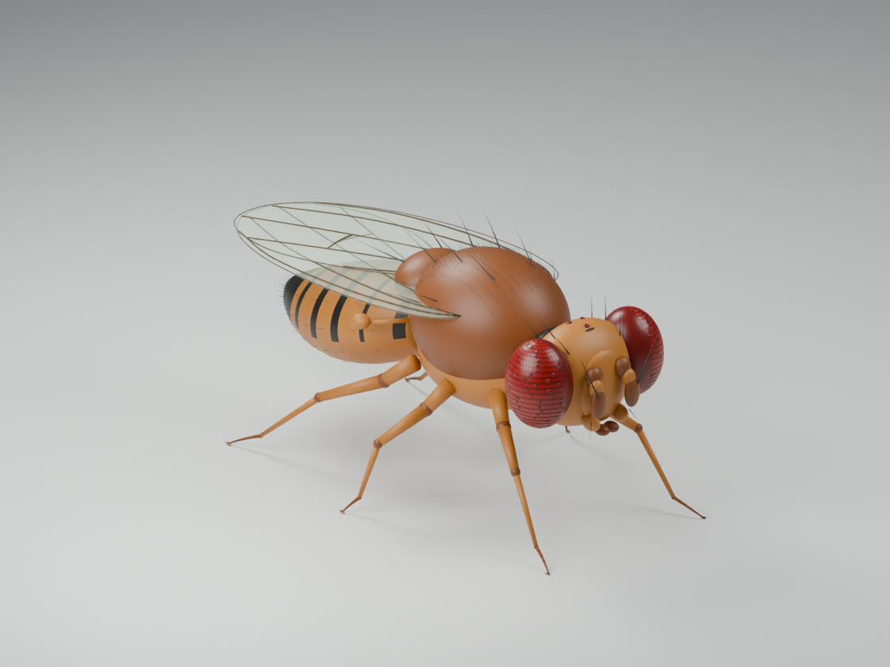

# SWARMSTRIKE

**Pilot a fly or a drone. Command a squad. Fight a swarm with connectome-derived steering.**

SWARMSTRIKE is a native **Rust / Bevy** aerial combat game. Choose 1–4 friendly
craft and face 1–4 opposing flies in an open-air arena with freestanding cover.
Every opponent has an independent spiking simulation built from the complete annotated
MaleCNS v1.0 neuron graph. Its output contributes to movement alongside
the game's navigation and combat controller.

[Download Windows game](https://github.com/feenix100/swarm_strike/releases/download/v0.7.0/Swarmstrike-Windows-x64-v0.7.0.zip) ·
[Release and gameplay videos](https://github.com/feenix100/swarm_strike/releases/tag/v0.7.0) ·
[Build from source](#build-from-source)



*In-engine gameplay. The GIFs are short, silent excerpts from autonomous matches
recorded with cinematic cameras in v0.7 on the expanded map using the full MaleCNS graph.*

[Play](#play) · [Controls](#controls) · [The mapped fly brain](#the-mapped-fly-brain) ·
[How the neural controller works](#how-the-neural-controller-works) · [Build](#build-from-source) ·
[Data and licensing](#data-and-licensing)

## The game

- **Choose fly or drone before deployment.** Fly is the default; opposing craft are always flies.
- **Command 1–4 craft.** Link their inputs to move, aim, boost, reload and fire simultaneously, or pilot one while wingmen follow orders.
- **Switch views instantly.** Use F1–F4 or Tab; each craft retains its own health and ammunition.
- **Commit to a burst.** Each click fires three rounds, followed by a cooldown. Holding the trigger does not repeat bursts.
- **Lead moving targets.** Projectiles travel through space and drop slightly; cover blocks visibility and shots.
- **Use a larger battlefield.** A 2,000-metre ground grid and 33 freestanding structures provide low bunkers, tall pylons, raised cover and routes to flank or climb.
- **Fly in open space.** No enclosing walls or roof, and no invisible horizontal edges or flight ceiling. The ground and cover remain solid.
- **Inspect the circuit.** F9 shows live activation, spikes and simulation steps for the opposing flies.

| Before deployment | During combat |
|---|---|
| [](docs/media/menu.png) | [](docs/media/combat.png) |

## Gameplay videos

Three 36-second, 1080p recordings of autonomous battles on the expanded map,
with event-synchronized game audio and cinematic cameras:

- [Drone Assault](https://github.com/feenix100/swarm_strike/releases/download/v0.7.0/Swarmstrike-01-Drone-Assault.mp4): chase, cockpit and rising overhead views.
- [On the Wing](https://github.com/feenix100/swarm_strike/releases/download/v0.7.0/Swarmstrike-02-On-the-Wing.mp4): close fly pursuit, reverse angles and orbiting views.
- [Crossfire](https://github.com/feenix100/swarm_strike/releases/download/v0.7.0/Swarmstrike-03-Crossfire.mp4): alternating teams, low passes and a wide finale.

Offline capture advances the full neural circuit at fixed model time, keeping
rendering delays separate from game time. The game uses its independent real-time
workers during play. See [video validation](docs/validation/gameplay-videos.json).

## The mapped fly brain

Versions 0.6 and later use **MaleCNS v1.0**, the male fruit fly brain, both optic
lobes and ventral nerve cord described in September 2026. Researchers at **HHMI
Janelia FlyEM, the University of Cambridge, MRC Laboratory of Molecular Biology,
Google Research and their collaborators** created the reconstruction using
electron microscopy, automated reconstruction and synapse detection, followed
by expert proofreading and annotation.
[Official project](https://male-cns.janelia.org/) ·
[Research announcement](https://research.google/blog/a-connectomics-milestone-mapping-the-complete-male-fruit-fly-brain/) ·
[Berg et al., Cell (2026)](https://doi.org/10.1016/j.cell.2026.08.015)

### What the data actually records

A **connectome** is a structural wiring map of a nervous system. Each reconstructed
neuron has an identifier. A directed connection records which neuron sends
synaptic contacts to which other neuron, and its integer weight counts those
reconstructed contacts. Several synapses can connect the same pair of cells.

The inputs used here are three **Feather tables**, a format for storing columns
of data. Together they describe cell identities, predicted chemical messengers,
and connectivity:

| Official input | What the table contains | How the game uses it |
|---|---|---|
| [Neuron annotations](https://storage.googleapis.com/flyem-male-cns/v1.0/connectome-data/flat-connectome/body-annotations-male-cns-v1.0-minconf-0.5.feather) | Original body IDs, classes, cell types and anatomical side labels | Preserves neuron identity, includes all class-annotated neurons, and identifies sensory and readout populations |
| [Neurotransmitter predictions](https://storage.googleapis.com/flyem-male-cns/v1.0/connectome-data/flat-connectome/body-neurotransmitters-male-cns-v1.0.feather) | Released transmitter predictions and consensus labels for cells | Supplies labels for the game's simplified positive/negative current rules |
| [Connection weights](https://storage.googleapis.com/flyem-male-cns/v1.0/connectome-data/flat-connectome/connectome-weights-male-cns-v1.0-minconf-0.5.feather) | `body_pre`, `body_post` and `weight`: the sending cell, receiving cell and synapse count | Supplies directed wiring and the counts used to calculate simulation currents |

For example, one actual row in the downloaded connection table is:

| `body_pre` | `body_post` | `weight` |
|---:|---:|---:|
| 10352 | 10351 | 2591 |

That row records **2,591 reconstructed synaptic contacts from neuron 10352 to
neuron 10351**. Its weight is an anatomical count. Rust turns these counts into
simulation currents using the model rules described below.

The tables provide structure and annotations. The membrane voltages, spikes and
movement seen in the game are generated by Rust at runtime. The fly's 3D mesh is
a separate artistic model; it was created from anatomical photo references.

### Where this build obtains the files

**The current game downloads directly from Janelia's official MaleCNS links,
hosted on Google Cloud Storage. Its connectome data does not come from a GitHub
repository or community fork.**

The three files above are the ones linked on
[Janelia's official download page](https://male-cns.janelia.org/download/).
Exact URLs, SHA-256 checksums and Google Storage generations are recorded in
[official-downloads.json](assets/neural/official-downloads.json). Both downloader
and importer pin the checksums. The original files remain unchanged under
`data/malecns-v1.0/`.

Versions through 0.5 used a smaller female FlyWire-derived graph packaged by
[snedea/flybrain](https://github.com/snedea/flybrain). That intermediate package
and its 8,593-neuron functional subset have been replaced with the direct official
MaleCNS import. The earlier choice was an implementation decision, not a Rust
limitation.

### What is imported into the game

The official full segment table also contains connections involving unclassified
segments, glia and fragments. The game includes **every one of the 166,700 neurons
with a published superclass annotation**, and **every official connection whose
two endpoints are among those neurons**. There is no functional-circuit selection,
minimum connection-weight threshold, side filter or neurotransmitter filter.
Weight-one connections and self-connections remain.

The import preserves original body IDs and integer synapse counts, while assigning
compact indices and grouping outgoing edges for efficient loading in Rust.
The independent validator compares every imported connection and count with the
official input table. Source fingerprints and conversion details are recorded in
[provenance.json](assets/neural/provenance.json).

| Quantity | Current runtime graph |
|---|---:|
| Published annotated neuron nodes | **166,700** |
| Directed neuron-pair connections | **25,582,938** |
| Sum of integer synapse counts between those neurons | **124,177,617** |
| Mutable neuron states per opponent | **166,700** |
| Mutable states with four opponents | **666,800** |
| Model timestep / target rate | **5 ms / 200 steps per second** |
| Gameplay physics rate | **60 Hz** |

The raw official table contains **151,856,684 segment-pair rows**;
**126,273,746** involve at least one endpoint outside the annotated neuron set.
Those rows remain in the original download but are excluded from the runtime
neuron graph. This is the full *annotated neuron graph*, rather than a simulation
of every raw segment or individual synapse location.

### How the data becomes a game controller

1. **Load the wiring.** Rust reads the imported graph and calculates normalized
   connection currents from the original synapse counts and transmitter labels.
2. **Supply observations.** Each opponent observes its own target's direction,
   elevation, proximity and visibility. An engineered encoder stimulates visual
   sensory cells; cover removes the target-derived visual input.
3. **Simulate activity.** A simplified leaky integrate-and-fire model generates
   voltages and spikes. Each opponent has independent cell state and shares only
   immutable wiring with the other opponents.
4. **Read movement signals.** Activity in descending and motor populations is
   decoded into lateral bias, vertical bias and movement gain.
5. **Apply game rules.** Rust blends those signals with navigation. Target
   selection, aiming, firing, reloads, evasion and collision handling use the
   game's programmed systems.

The reconstruction supplies biological connectivity. Electrical parameters,
sensory encoding and movement decoding are game-model choices, documented below.
The result is a connectome-based hybrid controller, not a validated biological
flight simulation or a brain trained to play this game.

## How the neural controller works



Each fly sends its target's relative bearing, elevation and proximity to an
engineered sensory encoder. Occluded targets supply zero target-derived input.
Currents stimulate official `ol_sensory` cells; anatomical left/right labels come
from `somaSide` or `rootSide`. An index-based vertical input split is an engineering
choice, not recovered retinal anatomy. Camera pixels are not simulated.

The circuit uses simplified **leaky integrate-and-fire** dynamics: voltages leak,
previous spikes propagate along the wiring, threshold crossings emit spikes,
and a refractory interval follows. There is **one state per neuron**, without the
artificially duplicated banks used in earlier versions.

The stored graph preserves unsigned integer synapse counts. At runtime, incoming
weights are normalized and transmitter predictions supply a simplified sign:
acetylcholine positive; GABA, glutamate and histamine negative; other/unclear
transmitters zero fast current. This omits slow neuromodulatory effects. Signs,
background currents, leak, threshold, gain and refractory time are **model
assumptions**, not measured physiology for every cell. No training modifies the
original wiring. See [neural_core.rs](src/neural_core.rs).

Positive membrane activity in descending and motor populations is decoded into
lateral bias, vertical bias and movement gain. Lateral differences use the
official anatomical side labels; the vertical population split is engineered.
The game blends these outputs into navigation:

```text
movement += target_tangent * neural.lateral * 0.9
movement += world_up       * neural.vertical * 0.7
movement *= 0.72 + neural.drive * 0.5
```

Target selection, aiming, ballistic lead, firing, reloads, boost, cover routing,
evasion and collisions remain conventional game systems. Wing motion is animated,
not simulated muscle mechanics. Player-controlled flies follow player input;
friendly wingmen use the game autopilot.

Up to four opponents share immutable wiring through Rust's `Arc`, while each owns
separate voltages, spikes, refractory counters, sensory input and output. Each runs
on its own worker. Physics consumes the latest completed output without waiting
for a neural step. Workers target 200 steps/second; if computation is slower,
neural time advances more slowly and telemetry reports the actual rate. It never
silently substitutes a smaller circuit. See [neural.rs](src/neural.rs).

This is a connectome-based hybrid controller. Full wiring does not make its
electrical parameters, sensory interface, combat decisions or body a validated
biological emulation.

## Watch the circuit while playing

Press **F9** to view the dataset, exact neuron and connection counts, total
synapse count, each opponent's spikes, steps and achieved update rate. Bars show
smoothed positive membrane activity across visual sensory, visual processing,
central complex, descending, motor and other neurons.


## Play

For a packaged build, extract it and run **`Launch-Swarmstrike.cmd`**. Keep the
`assets` directory beside the launcher. For a source checkout, use the build
instructions below; packaged executables in `bin/` are excluded from Git.

Before deploying, choose **Fly** or **Drone**, set both team sizes, and select
linked or solo control. Friendly flies have cyan eyes; opposing flies have red eyes.

**Linked:** all living friendly craft follow movement, aiming, boost, weapon,
reload and trigger inputs together. Switching changes the viewpoint.
**Solo:** pilot the viewed craft while wingmen follow Engage, Regroup or Hold
orders. Giving a wingman order switches to solo; B links the squad again.



### Burst weapons

Click once for three committed rounds. Release the trigger and wait for the
cooldown before firing another burst. Weapon switching cannot bypass the cooldown.

| Weapon | Damage per round | Projectile speed | Round spacing | Cooldown after burst | Magazine / reload |
|---|---:|---:|---:|---:|---|
| Needle | 12 | 75 m/s | 0.17 s | 1.25 s | 30 / 1.5 s |
| Stinger | 22 | 55 m/s | 0.23 s | 1.80 s | 15 / 2.3 s |

Shots arc downward. Aim ahead of motion and slightly above distant targets;
use cover and reposition during the reset. There is no friendly fire.
Destroyed craft respawn after three seconds, with control handed to a living
teammate when available. The kill goal is seven times the larger team size;
matches last three minutes before ties enter overtime.

## Controls

| Input | Action |
|---|---|
| P / J / K in the lab | Fly or drone / friendly count / opposing fly count |
| D / O in the lab | Deploy / observe |
| WASD / mouse | Move / aim and steer |
| **E / Q** | **Ascend / descend, beside WASD** |
| Shift / right mouse | Boost / precision aiming |
| Left mouse click | Three-round burst |
| 1 / 2 / R | Needle / Stinger / reload |
| F1–F4 / Tab / Shift+Tab | View a craft / next / previous living craft |
| B | Linked squad inputs / solo control |
| C / G / T | Wingman order / focus fire / cycle marked enemy |
| V / H / Escape | Camera view / Flight Manual / pause |
| F9 / F11 / F12 / M | Neural telemetry / fullscreen / screenshot / mute |
| Enter after a match | Play again |

<details>
<summary>Open the in-game Flight Manual screenshot</summary>



</details>

## The fly model



The original fly mesh has **133,696 triangles** per complete pose, with fine
corneal lenses, a tapered banded abdomen, six segmented legs, tarsal claws and
pulvilli, halteres, plumose antennae, curved bristles, and thin veined wings.
The lab folds the wings; gameplay animates the separate hinged wing meshes.

- [Resting fly STL](assets/models/fly_detailed.stl)
- [Spread-wing flight STL](assets/models/fly_flight.stl)
- [Photo references and modeling notes](assets/models/PHOTO-REFERENCES.md)

This display/game model was built from anatomical photo references. Its overlapping
closed components are not a boolean-unioned print-ready solid; small features need
preparation for physical printing. The art mesh is separate from the neural data.

## Build from source

Install a current Rust toolchain. To recreate the official data import, use
Python 3.11 or newer with `numpy` and `pyarrow`.

```powershell
git clone https://github.com/feenix100/swarm_strike.git
cd swarm_strike
```

You can also extract the [prepared runtime data](https://github.com/feenix100/swarm_strike/releases/download/v0.7.0/MaleCNS-v1.0-runtime.zip)
into the repository root, preserving its `assets/neural/` paths, and run
`cargo run --locked`. The following commands reproduce the import directly from
the official source files instead:


```powershell
python -m pip install numpy pyarrow
python tools/download_malecns.py
python tools/import_malecns.py --source data/malecns-v1.0
cargo run --locked
```

The preparation commands download the official inputs once and generate
`assets/neural/malecns-v1.0.bin`, which Rust loads at startup. Original downloads
and the generated binary are gitignored; source checkouts recreate them using
the commands above. The prepared game distribution includes the graph and runs
offline. See [Launch-Swarmstrike.cmd](Launch-Swarmstrike.cmd).

```powershell
cargo run --locked -- --pilot drone --drones 4 --flies 4
cargo run --locked -- --pilot fly --drones 1 --flies 4
cargo run --locked -- --pilot observe --telemetry
```

`--drones` sets friendly craft count for either chosen body; `--flies` sets enemy
count. `--solo` starts with wingman autopilot.

### Checks and measurements

```powershell
cargo test --locked
cargo fmt --all --check
cargo clippy --locked --all-targets -- -D warnings
python tools/validate_assets.py
python tools/validate_malecns.py --source data/malecns-v1.0
rustc -O --edition 2024 tools/benchmark_neural.rs -o benchmark_neural.exe
.\benchmark_neural.exe assets/neural/malecns-v1.0.bin 300
```

Full-data tests check dimensions, sensory response and the effect of removing
connection currents. The independent validator compares **every imported edge and
synapse count** with the official table. Small deterministic fixture circuits
keep game-rule tests independent of worker scheduling; they do not substitute for
the full-data checks. Native frame-rate and worker-throughput measurements are
recorded in [VALIDATION.md](VALIDATION.md).

Earlier v0.6: a 30-second native comparison on the development machine held approximately
**60 FPS** with either the old subset or four full MaleCNS circuits. The four full
circuits achieved approximately **196 neural steps/second** each against a 200-step
target. These are capped-frame-rate results on one machine, not minimum hardware requirements.

The expanded v0.7 map also held **60.02 FPS** in a 20-second four-opponent check; neural workers achieved approximately **198 steps/second** each. See the latest validation addendum.

Geometry can be regenerated with `python tools/build_assets.py --models-only`.
This does not rebuild or replace the neural data.

| File | Responsibility |
|---|---|
| [src/neural_core.rs](src/neural_core.rs) | Official graph loader, LIF dynamics, encoder and readout |
| [src/neural.rs](src/neural.rs) | Shared graph, independent workers and snapshots |
| [src/sim.rs](src/sim.rs) | Flight, navigation, combat, squads and match rules |
| [src/render.rs](src/render.rs) | Models, arena, cameras and effects |
| [src/ui.rs](src/ui.rs) | Lab, controls, HUD and neural telemetry |
| [tools/download_malecns.py](tools/download_malecns.py) | Direct official downloads with pinned hashes |
| [tools/import_malecns.py](tools/import_malecns.py) | Preserve annotated neuron IDs and all eligible integer connections |
| [tools/validate_malecns.py](tools/validate_malecns.py) | Independent full edge-by-edge comparison |

## Data and licensing

Original game code, mesh generation, artwork and synthesized sound use the
project's [MIT license](LICENSE). Dependencies retain their own licenses.

MaleCNS v1.0 data are **CC BY 4.0**, as stated by the
[official download page](https://male-cns.janelia.org/download/). Retain attribution
and disclose the import and modeling transformations. Credit belongs to the
HHMI Janelia FlyEM Project Team, University of Cambridge, MRC Laboratory of
Molecular Biology, Google Research and collaborators. See
[THIRD-PARTY-NOTICES.md](THIRD-PARTY-NOTICES.md) and
[provenance.json](assets/neural/provenance.json).

**Research reference:** Berg et al., *Sexual dimorphism in the complete Drosophila
male central nervous system connectome*, Cell (2026).
[doi:10.1016/j.cell.2026.08.015](https://doi.org/10.1016/j.cell.2026.08.015).
